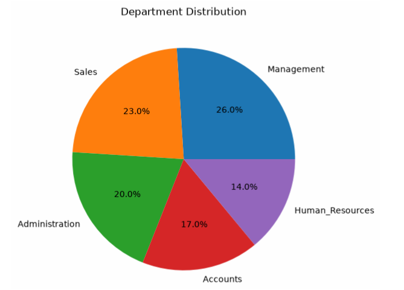
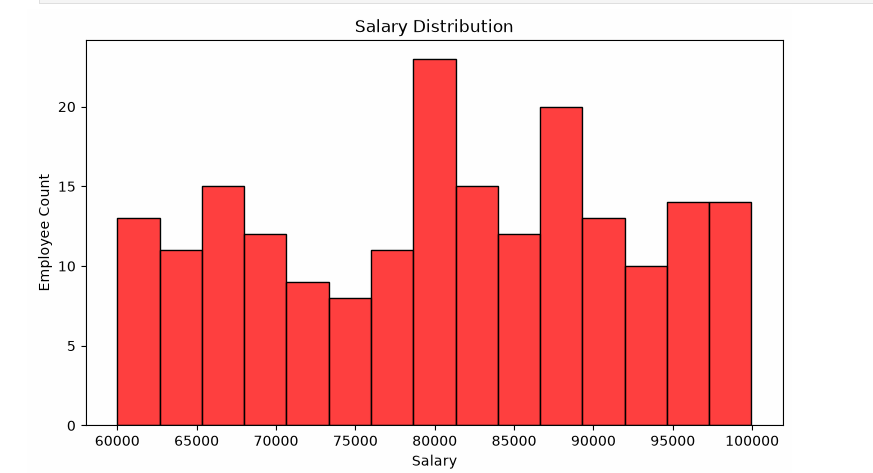

# Employee Data Cleaning & Visualisation (Python)

## Objective
Clean a messy employee dataset and visualise it to understand workforce patterns.

## Tools Used
Python: pandas, NumPy, Matplotlib, Seaborn

## Data Cleaning Steps
- Handled missing values
- Removed duplicate Employee IDs
- Treated salary and age outliers
- Fixed typos and inconsistent categories
- Standardised data types and dates

Dataset: 208 rows and 8 columns

## Visualisations
- Gender and department mix
- Salary and age distributions
- Year-wise hiring trend (peak in 2022)

## Project Files
- Data_Cleaning_Pandas_Visualisation.pdf: full code, outputs and charts
- Raw_Employee_Data.xls: raw dataset (before cleaning)
- Cleaned_Employee_Data.xlsx: cleaned dataset

## Chart Preview

### Department Distribution

### Salary Distribution

